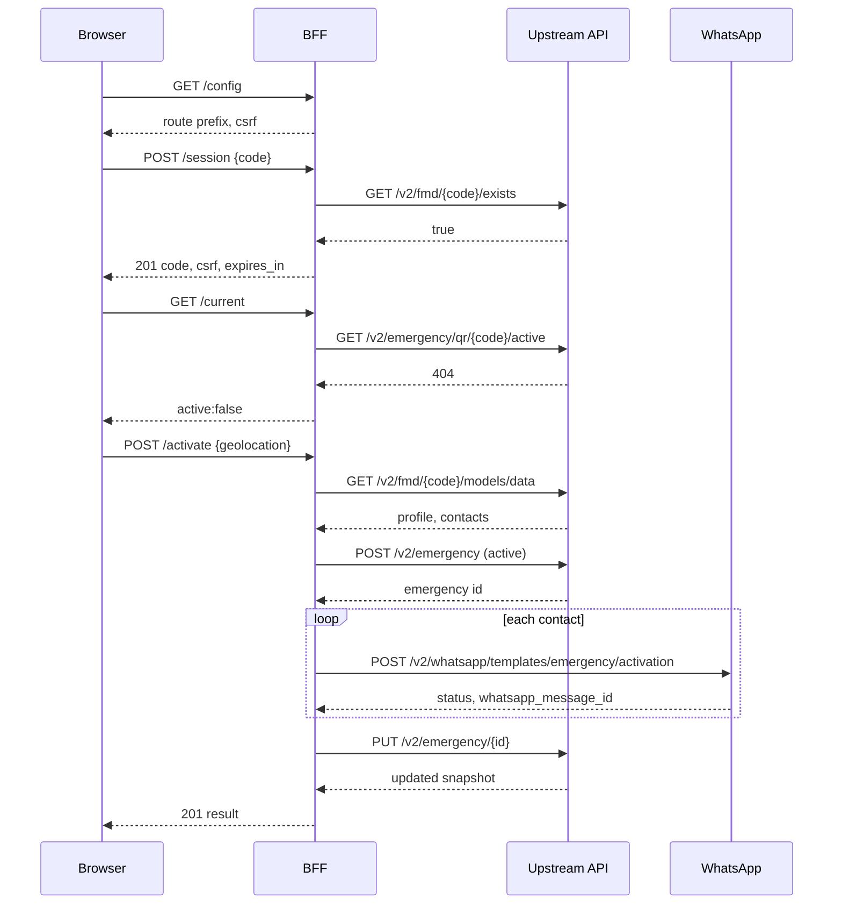

# API contract

Applies to: BFF integrators and frontend maintainers.

This is the HTTP contract between the browser and the BFF. It is versioned with
the BFF package. Additive fields are compatible; removing or renaming a field is
breaking.

## Base URL

```text
{origin}{EMERGENCY_BFF_ROUTE_PREFIX}
```

Default: `https://example.com/de-bff/emergency`.

All requests and responses are JSON except `204 No Content` responses and the
static demo page. Every response includes:

```http
X-Request-Id: 9f2c1a7b4e8d0c31
Cache-Control: no-store
```

The browser must send cookies. The BFF session cookie is HTTP-only by default.

## Middleware order

```text
SameOrigin → Session → RateLimit → CSRF → route
```

Cross-origin requests are rejected before the session is read. A missing session
returns `401` before CSRF is checked. CSRF applies to `POST`, `PUT`, `PATCH` and
`DELETE`.

## Endpoints

| Method   | Path            | Auth           | Purpose                                 |
| -------- | --------------- | -------------- | --------------------------------------- |
| `GET`    | `/health`       | none           | Liveness and service name.              |
| `GET`    | `/config`       | none           | Route prefix and CSRF token.            |
| `POST`   | `/session`      | none           | Validate a code and create the session. |
| `GET`    | `/current`      | session        | Active emergency for this identity.     |
| `POST`   | `/activate`     | session + CSRF | Create a real emergency.                |
| `POST`   | `/simulacrum`   | session + CSRF | Send a test message.                    |
| `POST`   | `/{id}/refresh` | session + CSRF | Re-read an emergency.                   |
| `DELETE` | `/{id}`         | session + CSRF | Abort an emergency.                     |

`{id}` is the upstream emergency identifier returned by activation or
`GET /current`.

## Health

```http
GET /health
```

```json
{
  "status": "ok",
  "service": "dataemergencia/emergency-bff"
}
```

No session, no CSRF. Use it for load balancers and startup checks.

## Config

```http
GET /config
```

```json
{
  "route_prefix": "/de-bff/emergency",
  "csrf_token": "…"
}
```

`csrf_token` is also issued by `POST /session`; use the newest value.

This endpoint is safe to call before a session exists. Do not cache it.

## Session

```http
POST /session
Content-Type: application/json

{ "code": "DABC12" }
```

The code must match `^[A-Za-z][A-Za-z0-9]{5}$` and exist upstream.

```http
201 Created
```

```json
{
  "code": "DABC12",
  "csrf_token": "…",
  "expires_in": 3600
}
```

Creating a session regenerates the PHP session ID and rotates the CSRF token.
`expires_in` is the configured sliding TTL, in seconds.

Errors:

| Status | Code                | Cause                         |
| ------ | ------------------- | ----------------------------- |
| 422    | `validation_failed` | Blank or malformed body/code. |
| 422    | `invalid_code`      | Code shape is invalid.        |
| 404    | `inactive_code`     | Code not found upstream.      |
| 502    | `upstream_error`    | Upstream lookup failed.       |

## Current

```http
GET /current
```

```json
{
  "active": true,
  "emergency": {
    "emergency_id": "EMG123456",
    "initiator_id": "DABC12",
    "reporter_phone": "+584121301234",
    "is_active": true,
    "is_simulated": false,
    "created_at": "2026-10-28T14:05:00Z",
    "updated_at": "2026-10-28T14:06:00Z",
    "responders": [ … ]
  }
}
```

When no emergency exists:

```json
{ "active": false, "emergency": null }
```

`GET /current` is how a reload discovers an emergency. It is also the
reconciliation source when realtime is unavailable.

`reporter_phone` is `null` when no reporter phone was supplied for that
emergency.

## Activate

```http
POST /activate
Content-Type: application/json
X-CSRF-Token: …
Idempotency-Key: 6f1c…

{
  "geolocation": {
    "latitude": 4.711,
    "longitude": -74.0721,
    "accuracy": 12
  },
  "reporter_phone": "+584121301234"
}
```

`geolocation` is optional. The BFF accepts both flat `latitude`/`longitude`
fields and a nested `coords` object, validates that the coordinates are numeric,
flattens them, and forwards the result to the upstream `POST /v2/emergency` as
`geolocation` with `is_simulated: false`. `accuracy` is forwarded when present;
the API maps it to `accuracy_meters`. Invalid values return
`422 validation_failed` before any upstream call. The BFF does not persist the
location or generate map links; the API stores it through its own domain event.

`reporter_phone` is optional. When present it must be an E.164 value: an
optional leading `+` followed by 7–15 digits. The BFF trims it and forwards it
to the upstream `POST /v2/emergency`; a malformed value returns
`422 validation_failed` before any upstream call.

```http
201 Created
```

```json
{
  "emergency_id": "EMG123456",
  "simulated": false,
  "reporter_phone": "+584121301234",
  "responders": [
    {
      "phone": "573001234567",
      "name": "Ana Pérez",
      "sent": true,
      "delivered": false,
      "read": false,
      "failed": false,
      "message_id": "wamid.…"
    }
  ],
  "failures": [],
  "partial_failure": false,
  "total_failure": false
}
```

The response does not include the internal snapshot. Frontends reconstruct it
from the returned fields.

`reporter_phone` is `null` when no reporter phone was supplied on activation.

Behavior:

1. If an emergency is already active for the code, return `409`.
2. Fetch the medical profile; require personal information and contacts.
3. Create the upstream emergency active so the typed template has an
   `emergency_code`.
4. Send one typed activation message per contact with that emergency id.
5. If every send fails, delete the created emergency and return `502`.
6. Otherwise write the responder WAMIDs and statuses back through
   `PUT /v2/emergency/{id}` and return the result.

Partial failures keep the emergency and appear in `failures`.

A `2xx` send response without a valid `wamid.`-prefixed id counts as a failure
for that responder (`sent: false`, `failed: true`, `message_id: null`), so the
total and partial failure rules above apply unchanged. The failure entry keeps
the real HTTP status in `failures[].status`.

Errors:

| Status | Code                         | Cause                         |
| ------ | ---------------------------- | ----------------------------- |
| 409    | `emergency_already_active`   | An active emergency exists.   |
| 422    | `missing_medical_profile`    | Profile has no personal data. |
| 422    | `missing_emergency_contacts` | Profile has no contacts.      |
| 502    | `whatsapp_delivery_failed`   | Every contact failed.         |
| 502    | `upstream_error`             | Upstream API failure.         |

Retry with the same `Idempotency-Key` returns the stored result instead of
creating a second emergency. The key comes from the `Idempotency-Key` header or
the `idempotency_key` body field. The default store is in-memory and per process;
configure a shared store before running multiple PHP workers.

## Simulacrum

```http
POST /simulacrum
X-CSRF-Token: …
Content-Type: application/json
```

```json
{
  "geolocation": {
    "latitude": 4.711,
    "longitude": -74.0721,
    "accuracy": 12
  }
}
```

The body is optional. `geolocation` follows the same rules as `/activate`:
flat or nested coordinates, numeric validation, and a `422 validation_failed`
before any upstream call when invalid. The BFF forwards it to
`POST /v2/emergency` with `is_simulated: true` and `is_active: true`, so the
API can persist the location and distinguish the simulacrum from a real
emergency. The BFF itself does not persist locations.

```json
{
  "emergency_id": null,
  "simulated": true,
  "responders": [ … ],
  "failures": [],
  "partial_failure": false,
  "total_failure": false
}
```

Simulation never checks for an existing active emergency. It pre-creates an
active simulated emergency only to obtain a valid `emergency_code`, leaves it
active and does not update it. A total delivery failure deletes that record and
returns `502 whatsapp_delivery_failed`.

## Refresh

```http
POST /{id}/refresh
X-CSRF-Token: …
```

```json
{
  "emergency": {
    "emergency_id": "EMG123456",
    "initiator_id": "DABC12",
    "reporter_phone": "+584121301234",
    "is_active": true,
    "is_simulated": false,
    "responders": [
      {
        "phone": "573001234567",
        "name": "Ana Pérez",
        "sent": true,
        "delivered": false,
        "read": false,
        "failed": false,
        "message_id": "42"
      }
    ]
  }
}
```

On `POST /{id}/refresh` (and `GET /current`), `message_id` is the upstream
internal message id, exposed as a decimal string. It correlates the responder
with delivery state; it is **not** a WAMID and must not be sent back to the
create endpoint.

`404 emergency_not_found` if upstream no longer has the emergency.

> [!WARNING]
> **Ownership limitation in 0.1.1.** `POST /{id}/refresh` checks that a session
> exists but does not verify that the emergency belongs to the session identity.
> Treat emergency IDs as non-guessable and do not expose this deployment to
> mutually untrusted tenants until the ownership check ships. See
> [Security](bff/security.md#known-limitation-refresh-ownership).

## Abort

```http
DELETE /{id}
X-CSRF-Token: …
```

```json
{
  "emergency_id": "EMG123456",
  "simulated": false,
  "responders": [ … ],
  "failures": [],
  "partial_failure": false,
  "total_failure": false,
  "deleted": true
}
```

The BFF sends the abort template to the contacts, then deletes the upstream
emergency. The response includes the delivery result. `deleted: true` means the
upstream delete succeeded; a WhatsApp failure is reported in `failures` but does
not roll back the deletion.

Errors: `404 emergency_not_found`, `403 emergency_forbidden`,
`502 upstream_error`.

## Responder and failure

```json
{
  "phone": "573001234567",
  "name": "Ana Pérez",
  "sent": true,
  "delivered": true,
  "read": false,
  "failed": false,
  "message_id": "42"
}
```

`message_id` is always `string | null`, but its meaning depends on the
endpoint. Activation, simulacrum and abort responses carry the WhatsApp
**WAMID** returned by the send endpoint (for example `wamid.…`). `GET /current`
and `POST /{id}/refresh` carry the upstream **internal** message id, normalized
to a decimal string (`42` → `"42"`). The internal id is a display/correlation
value and must never be fed back into `POST /v2/emergency`.

Phones are digits with the leading `+` removed, as used by the upstream API.

A failure has `{ phone, message, status? }`. `partial_failure` is true when there
is at least one failure but not every responder failed.

## Error envelope

```json
{
  "error": {
    "code": "invalid_code",
    "message": "Human-readable message.",
    "details": {},
    "request_id": "9f2c1a7b4e8d0c31"
  }
}
```

`details` is `null` or an object. `request_id` matches the `X-Request-Id`
response header.

### Taxonomy

| HTTP | `error.code`                 | Meaning                                                        |
| ---- | ---------------------------- | -------------------------------------------------------------- |
| 401  | `unauthenticated`            | No or expired session.                                         |
| 403  | `cross_origin_denied`        | `Origin` host/port differs from `Host`.                        |
| 403  | `csrf_failed`                | Missing or stale CSRF token.                                   |
| 403  | `emergency_forbidden`        | The identity may not act on this emergency.                    |
| 404  | `not_found`                  | Unknown route.                                                 |
| 404  | `inactive_code`              | Code not found upstream.                                       |
| 404  | `emergency_not_found`        | Emergency does not exist upstream.                             |
| 405  | `method_not_allowed`         | Wrong method; `details.allowed` lists methods.                 |
| 409  | `emergency_already_active`   | Active emergency exists.                                       |
| 422  | `validation_failed`          | Body validation failed.                                        |
| 422  | `invalid_code`               | Code shape is invalid.                                         |
| 422  | `missing_medical_profile`    | No personal profile.                                           |
| 422  | `missing_emergency_contacts` | No emergency contacts.                                         |
| 429  | `rate_limited`               | Too many requests; see `details.retry_after`.                  |
| 500  | `emergency_error`            | Domain error without a mapping.                                |
| 500  | `internal_error`             | Unhandled exception.                                           |
| 502  | `upstream_error`             | Upstream API error; `details.status`, `details.upstream_code`. |
| 502  | `whatsapp_delivery_failed`   | Every WhatsApp send failed.                                    |

Frontends map `network` and transport failures locally; they have no BFF code.

## Status codes

- `200`: read or action succeeded.
- `201`: session or emergency created.
- `204`: only for internal upstream deletes; BFF abort returns `200` with
  `deleted: true`.
- `429`: caller error; wait `details.retry_after` seconds before retrying.
- `5xx`: retry with backoff once; activation is safe to retry with the same
  idempotency key.

## Rate limiting

Default: 60 requests per 60 seconds per session, keyed by
`METHOD:path`. Exceeding it returns:

```json
{
  "error": {
    "code": "rate_limited",
    "message": "Too many requests. Please retry later.",
    "details": { "retry_after": 60 },
    "request_id": "…"
  }
}
```

`details.retry_after` is the limiter window length in seconds, not a countdown.
Wait that long before retrying. The limiter is session-backed; unauthenticated
routes are not limited by it.

## Sequence



## Upstream mapping

| BFF action       | Upstream endpoint                                          |
| ---------------- | ---------------------------------------------------------- |
| Validate code    | `GET /v2/fmd/{code}/exists`                                |
| Read profile     | `GET /v2/fmd/{code}/models/data?model=personal,emergencia` |
| Create emergency | `POST /v2/emergency`                                       |
| Update emergency | `PUT /v2/emergency/{id}`                                   |
| Read emergency   | `GET /v2/emergency/{id}`                                   |
| Find active      | `GET /v2/emergency/qr/{code}/active`                       |
| Delete emergency | `DELETE /v2/emergency/{id}`                                |
| Send activation  | `POST /v2/whatsapp/templates/emergency/activation`         |
| Send simulacrum  | `POST /v2/whatsapp/templates/emergency/simulacrum`         |
| Send abort       | `POST /v2/whatsapp/templates/send`                         |

See [Upstream API](bff/upstream-api.md) for payloads and normalization.

## Collections

The `examples/api` directory contains a curl script and a Postman collection
covering session, current, activate, simulacrum, refresh and abort. They run
against the mock API and the BFF demo.
