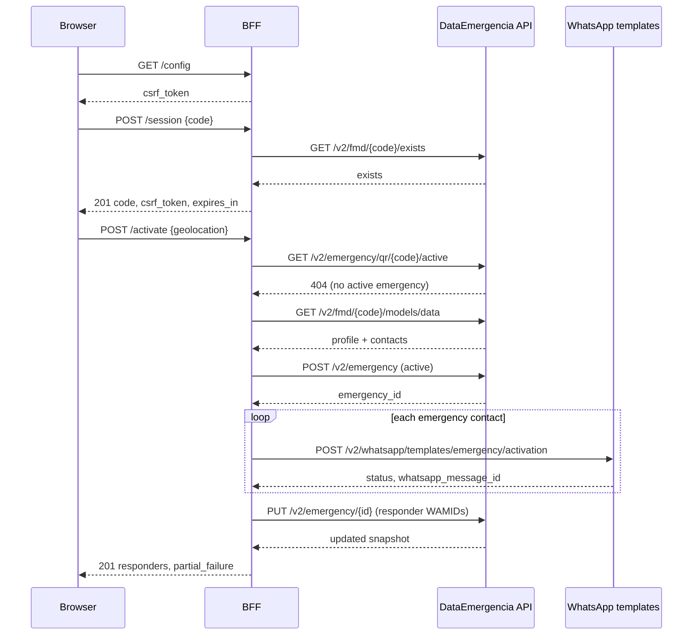

# Activation flow

Applies to: integrators and maintainers.

What happens between the SOS trigger and the responders' WhatsApp messages,
including the failure and resume paths. Request and response shapes are in the
[HTTP contract](routes.md); this page covers the order and the business rules.

## Sequence

## 1. Session

`POST /session` validates the format and upstream existence, then binds the code
to the browser session. Profile data is not fetched yet: a session only proves
which code the browser started.

## 2. Activation request

`POST /activate` accepts optional `geolocation` (flat or nested `coords`,
numeric validation) and optional `reporter_phone` (E.164). Both are validated
before any upstream call. The BFF does not store the location; it forwards it so
the API can persist it through its own domain event.

The location is not part of the WhatsApp template. The API builds the Meta
payload, including the template name, image, date, QR link and map data.

An `Idempotency-Key` scopes a cached result to `operation:code:key`. A retry with
the same key returns the first result and does not send messages twice; a
different key starts a new attempt. Use one key per user action.

## 3. Preconditions

The BFF checks for an existing active emergency first. If one exists it returns
`409 emergency_already_active` without reading the profile or sending messages.

It then requires a profile with usable personal information and at least one
contact with a phone number. Missing data returns
`422 missing_medical_profile` or `422 missing_emergency_contacts`. Refusing to
activate on an incomplete profile is deliberate: a partial alert is worse than a
clear error.

## 4. Emergency creation

The upstream emergency is created active _before_ any message is sent, with the
responders from the profile, `initiator_id: code`, `is_simulated: false` and the
validated geolocation.

The order is required: the typed template uses the emergency id as its
`emergency_code` URL suffix, and the API charges the emergency's `initiator_id`.
An upstream `409` during creation becomes `409 emergency_already_active`, so a
race between two activations still returns the domain error.

## 5. Message dispatch

One typed activation message is sent per contact, sequentially. The API owns
the template content; the BFF sends the recipient phone and the variables
`user_name` and `emergency_code` (see
[WhatsApp payloads](whatsapp-payloads.md)).

A send succeeds only when the upstream response carries a valid WhatsApp
message id (see [WhatsApp payloads](whatsapp-payloads.md#response)). A `200`
with `status: failed` or a missing id counts as a failed responder, because the
reference is what the delivery webhooks match on. A responder is never reported
as sent without it.

Outcomes:

- **Every send fails** → the created emergency is deleted and the caller gets
  `502 whatsapp_delivery_failed`. No alert exists, so no phantom emergency is
  left active.
- **At least one send succeeds** → responder statuses and WAMIDs are written
  back through `PUT /v2/emergency/{id}`. Failed contacts stay in `failures` and
  `partial_failure` is true.
- **`402 INSUFFICIENT_CREDITS`** → the fan-out stops, the created emergency is
  deleted and the caller gets `402 insufficient_credits`. Billed sends are not
  attempted without credit.

## 6. Abort

`DELETE /{id}` verifies that the caller's code owns the active emergency, sends
`emergency_status_aborting_v1` to the same contacts, deletes the upstream
emergency and clears the session snapshot.

The abort template is sent through the typed abort endpoint; endpoint and
billing behavior live in [WhatsApp payloads](whatsapp-payloads.md). A WhatsApp
failure is reported in `failures` but does not roll back the deletion. An
emergency that no longer exists returns `404 emergency_not_found`; one owned by
another code returns `403 emergency_forbidden`.

## 7. Resume

On page load, `GET /current` asks upstream for the active emergency by code. If
one exists, the BFF caches and returns it and the frontend renders the delivery
state. If not, the snapshot is cleared and the frontend stays idle.

## 8. Refresh and realtime

`POST /{id}/refresh` re-reads the emergency and its responder statuses. Call it
on mount, after a realtime event, on tab focus, on network reconnect and at a
throttled interval. Delivery state is read, never inferred from a realtime
payload.

Realtime is optional and owned by the API. The BFF exposes no Pusher
configuration and returns no realtime block; the browser library mounts with its
own public settings.

## Simulation

`POST /simulacrum` follows the same profile and contact checks and accepts the
same optional geolocation. It creates an active simulated emergency first, only
to obtain a valid `emergency_code`, then sends
`POST /v2/whatsapp/templates/emergency/simulacrum` with `contact_name`,
`user_name` and `emergency_code`.

The created record stays active and is never written back. The API's scheduled
cleanup deactivates it, so upstream active-emergency lookups can surface it in
the meantime. When every send fails, or the API rejects the send for credits,
the BFF deletes the record it created. The response reports
`simulated: true` and `emergency_id: null`.

Simulation does not check for an existing real emergency. Blocking that case is
a frontend responsibility.

## Idempotency and retries

- Reads are retried by the HTTP client; writes are not.
- Activation and simulation are idempotent only with a caller-supplied key.
- The default idempotency store is in-memory and per process. Under PHP-FPM it
  is bounded by the worker lifetime; multi-instance deployments need a shared
  store.
