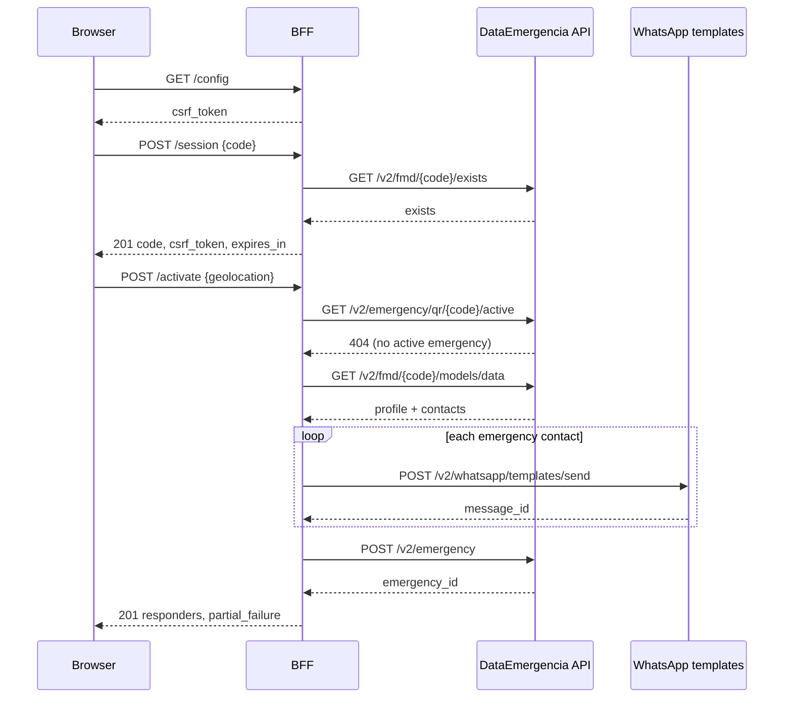

# Activation flow

Applies to: integrators and maintainers.

This page describes what happens between the SOS trigger and the responders'
WhatsApp messages, including the failure and resume paths.

## Sequence

## Step by step

### 1. Session

`POST /session` validates the format and the upstream existence, then stores the
identity under a regenerated session ID. The response contains a fresh CSRF
token. No profile data is fetched yet.

### 2. Activation request

`POST /activate` receives the current position. The BFF accepts either flat
`latitude`/`longitude` fields or a nested `coords` object. Coordinates are
optional at the HTTP layer but a real activation without a position produces a
template with empty map values, so clients should always send them or use the
fallback phone path.

The optional `Idempotency-Key` header (or `idempotency_key` body field) scopes a
cached result to `operation:code:key`. Repeating the same key returns the first
result and does not send messages twice. A different key creates a new attempt.

### 3. Preconditions

The BFF checks for an existing active emergency first. If one exists, it returns
`409 emergency_already_active` and does not fetch the profile or send messages.
A frontend should catch this code, hydrate the active emergency and render its
active state instead of treating it as a hard failure.

It then fetches the profile and requires:

- personal information with a usable name, and
- at least one emergency contact with a phone number.

Missing data returns `422 missing_medical_profile` or
`422 missing_emergency_contacts`.

### 4. Message dispatch

For each contact, the BFF builds the `emergency_message_template_v3` payload
with the contact name, user name, Spanish activation date, QR URL and map
coordinates. It sends each message independently and records `sent`,
`delivered`, `read`, `failed` and `message_id` per responder.

The QR code in the emergency template is the first valid product code, or the
identity code when no product code is available.

A send counts as successful only when the API returns a valid `wamid.`-prefixed
id. A `2xx` response without one is recorded as a failure for that responder
(`sent: false`, `failed: true`, `message_id: null`), because a responder must
never be reported as sent without the reference webhooks match on.

If every send fails, the BFF returns `502 whatsapp_delivery_failed` and does not
create the upstream emergency. If some fail, the emergency is created and the
response has `partial_failure: true` and a `failures` array whose entry keeps the
real HTTP status.

### 5. Emergency creation

Only after a successful dispatch does the BFF create the upstream emergency with
the responders array and `initiator_id: code`. The snapshot is stored in the
session and returned to the caller.

### 6. Abort

`DELETE /{id}` verifies that the caller's code owns the active emergency, sends
`emergency_status_aborting_v1` to the same contacts, deletes the upstream
emergency and clears the session snapshot. It returns `deleted: true`.

A code that does not own the emergency gets `403 emergency_forbidden`. An
emergency that no longer exists gets `404 emergency_not_found`.

### 7. Resume

On page load, `GET /current` asks upstream for the active emergency by code. If
one exists, the BFF stores and returns it and the frontend renders the delivery
status. If not, the session snapshot is cleared and the frontend stays idle.

### 8. Refresh and realtime

`POST /{id}/refresh` re-reads the emergency and its responder statuses.
Frontends should call it after realtime events, on tab focus, on network
reconnect and at a throttled interval. Delivery statuses are read, not inferred.

## Simulation

`POST /simulacrum` follows the same profile and contact checks, but sends
`simulacrum_support_contacts_confirmation_v2` and never calls
`POST /v2/emergency`. The response has `simulated: true` and
`emergency_id: null`, so a simulation cannot be resumed or aborted as a real
emergency.

## Idempotency and retries

- Reads are retried by the HTTP client.
- Activation and simulation are idempotent only when the caller supplies a key.
- The default in-memory idempotency store is per-process. Under PHP-FPM it is
  bounded by the worker lifetime; a shared store is a post-MVP concern for
  multi-instance deployments.
- The browser should generate one key per user action and reuse it on retry.

## Next step

[WhatsApp payloads](whatsapp-payloads.md).
