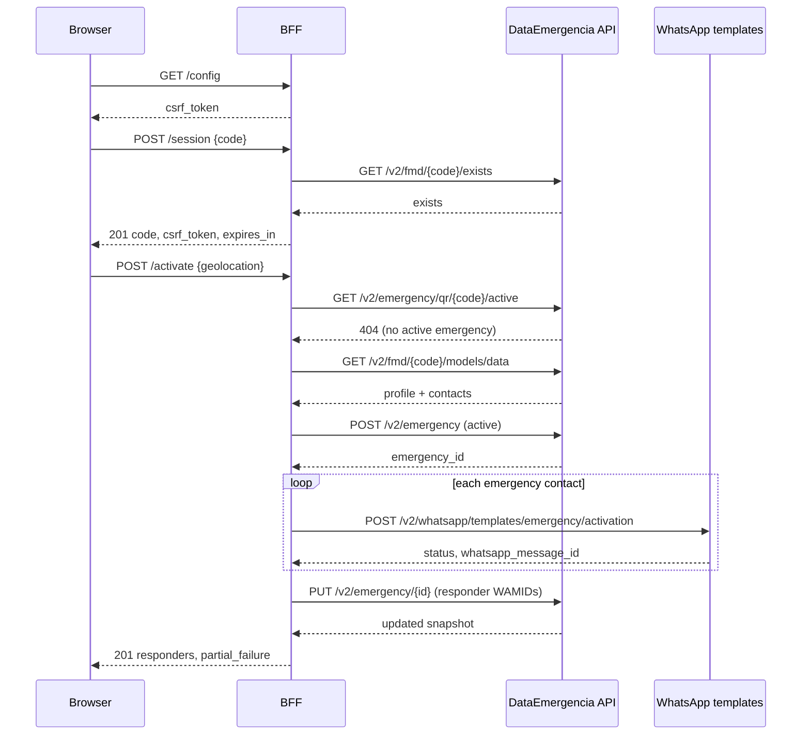

# Activation flow

Applies to: integrators and maintainers.

This page describes what happens between the SOS trigger and the responders'
WhatsApp messages, including the failure and resume paths.

## Sequence

## Step by step

### 1. Session

`POST /session` validates the format and the upstream existence, then stores the
identity under a regenerated session ID. The response contains a fresh CSRF
token. No profile data is fetched yet.

### 2. Activation request

`POST /activate` accepts either flat `latitude`/`longitude` fields or a nested
`coords` object. Coordinates remain optional and are validated when present,
then flattened and forwarded to the upstream `POST /v2/emergency` as
`geolocation` together with `is_simulated: false`. The BFF does not persist the
location; the API stores it through its own domain event. The typed activation
template does not consume the coordinates, because the API owns the Meta
payload.

The optional `Idempotency-Key` header (or `idempotency_key` body field) scopes a
cached result to `operation:code:key`. Repeating the same key returns the first
result and does not send messages twice. A different key creates a new attempt.

### 3. Preconditions

The BFF checks for an existing active emergency first. If one exists, it returns
`409 emergency_already_active` and does not fetch the profile or send messages.
A frontend should catch this code, hydrate the active emergency and render its
active state instead of treating it as a hard failure.

It then fetches the profile and requires:

- personal information with a usable name, and
- at least one emergency contact with a phone number.

Missing data returns `422 missing_medical_profile` or
`422 missing_emergency_contacts`.

### 4. Emergency creation

The BFF creates the upstream emergency active before sending, with the
responders from the profile, `initiator_id: code`, `is_simulated: false` and the
validated `geolocation` when supplied. The typed templates use the emergency id
as their `emergency_code` URL suffix, so the record must exist first. An
upstream `409` during creation becomes `409 emergency_already_active`, so a race
still returns the domain error.

### 5. Message dispatch

For each contact, the BFF calls `POST /v2/whatsapp/templates/emergency/activation`
with the recipient phone and the variables `user_name` and `emergency_code`
(the created emergency id). The API builds the Meta payload, including the
template name, image, Spanish date, QR URL and map coordinates.

A send counts as successful only when the nested result has `status: sent` and a
valid `wamid.`-prefixed `whatsapp_message_id`. A `200` with `status: failed` or a
missing WAMID is recorded as a failure for that responder (`sent: false`,
`failed: true`, `message_id: null`), because a responder must never be reported
as sent without the reference webhooks match on.

If every send fails, the BFF deletes the emergency it just created and returns
`502 whatsapp_delivery_failed`. If at least one succeeds, the BFF writes the
responder statuses and WAMIDs back through `PUT /v2/emergency/{id}` and returns
the updated snapshot with `partial_failure` when applicable. The failure entry
keeps the real HTTP status.

### 6. Abort

`DELETE /{id}` verifies that the caller's code owns the active emergency, sends
`emergency_status_aborting_v1` to the same contacts, deletes the upstream
emergency and clears the session snapshot. It returns `deleted: true`.

A code that does not own the emergency gets `403 emergency_forbidden`. An
emergency that no longer exists gets `404 emergency_not_found`.

### 7. Resume

On page load, `GET /current` asks upstream for the active emergency by code. If
one exists, the BFF stores and returns it and the frontend renders the delivery
status. If not, the session snapshot is cleared and the frontend stays idle.

### 8. Refresh and realtime

`POST /{id}/refresh` re-reads the emergency and its responder statuses.
Frontends should call it after realtime events, on tab focus, on network
reconnect and at a throttled interval. Delivery statuses are read, not inferred.

## Simulation

`POST /simulacrum` follows the same profile and contact checks. It accepts the
same optional `geolocation` payload as `/activate`, validates and flattens it,
then first creates an inactive emergency with `is_simulated: true` and the
validated `geolocation` to obtain a valid `emergency_code`. The API persists the
simulated emergency's location through its own domain event; the BFF does not
store it. The BFF then calls
`POST /v2/whatsapp/templates/emergency/simulacrum` with `contact_name`,
`user_name` and `emergency_code`. The created record stays inactive and is never
written back. When every send fails, the BFF deletes the record it created.

The response has `simulated: true` and `emergency_id: null`, so a simulation
cannot be resumed or aborted as a real emergency.

## Idempotency and retries

- Reads are retried by the HTTP client.
- Activation and simulation are idempotent only when the caller supplies a key.
- The default in-memory idempotency store is per-process. Under PHP-FPM it is
  bounded by the worker lifetime; a shared store is a post-MVP concern for
  multi-instance deployments.
- The browser should generate one key per user action and reuse it on retry.

## Next step

[WhatsApp payloads](whatsapp-payloads.md).
